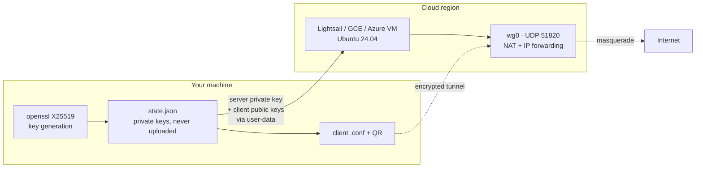

# Create Your Own VPN Server

**Run your own WireGuard VPN on AWS, Google Cloud, or Azure with one command — free for your first 6–12 months on cloud free-tier credits, then about $0.42/month.**

[](https://github.com/shihabshahrier/Create-Your-Own-Vpn-Server/actions/workflows/ci.yml)
[](LICENSE)
[](CONTRIBUTING.md)
[](AGENTS.md)

```bash
git clone https://github.com/shihabshahrier/Create-Your-Own-Vpn-Server.git
cd Create-Your-Own-Vpn-Server
./vpn.sh up aws us-west-2 --clients laptop,phone
```

Sixty seconds later you have a `.conf` file and a QR code. Scan it, connect, done.
When you're finished, `./vpn.sh down aws us-west-2` deletes the server and the
billing stops.

> **Found this useful?** A ⭐ helps other people find it — and tells me which parts
> are worth building out next.

---

## Contents

- [What this is, in one paragraph](#what-this-is-in-one-paragraph)
- [What it costs](#what-it-costs)
- [How to run a VPN server for free](#how-to-run-a-vpn-server-for-free)
- [Quick start](#quick-start)
- [How it works](#how-it-works)
- [Command reference](#command-reference)
- [Multi-region](#multi-region)
- [Choosing a DNS resolver](#choosing-a-dns-resolver)
- [Security model](#security-model)
- [Troubleshooting](#troubleshooting)
- [FAQ](#faq)
- [Comparison with other options](#comparison-with-other-options)
- [Contributing](#contributing)

---

## What this is, in one paragraph

A single shell script that provisions a hardened WireGuard VPN server in any
cloud region, generates the keys, writes your client configs, and tears the
server down again. It is not a VPN service and it does not proxy your traffic —
you own the server, the keys never leave your laptop, and there is no third party
in the path. It exists because commercial VPNs ask you to move your trust from an
ISP you can audit to a company you cannot, and because every "set up WireGuard"
guide stops at a wall of manual `iptables` commands.

Three things make it different from the usual install script: it provisions the
**cloud infrastructure** too, not just the software; it is built for **destroying
and recreating** servers so you pay by the hour; and it needs **no WireGuard tools
installed locally**, because keys are derived with OpenSSL's X25519 (verified in
CI against the RFC 7748 test vector and against `wg pubkey` itself).

---

## What it costs

The tool defaults to **Amazon Lightsail**, which bundles a public IPv4 address and
a large transfer allowance into one flat price. EC2 charges for both separately
and works out roughly 2.4× more expensive for a VPN's shape of workload:

| Option | Per month | Egress included | Notes |
| --- | --- | --- | --- |
| **[Lightsail](https://aws.amazon.com/lightsail/pricing/) `nano`** | **$5.00** | 1 TB (US/EU), 512 GB (APAC) | 2 vCPU, 512 MB, IPv4 included |
| Lightsail `nano` IPv6-only | $3.50 | same | Unreachable from IPv4-only networks |
| Lightsail `micro` | $7.00 | 2 TB / 1 TB | 1 GB RAM |
| EC2 `t3.micro` + IPv4 + 8 GB EBS | ~$11.88 | 100 GB account-wide | Then $0.09/GB |

### Why it can cost cents instead of dollars

Lightsail bills **hourly and prorated**. You can only be connected to one region
at a time. So if you delete the server when you're done, **the number of regions
you use stops mattering — only connected hours do:**

| Usage | Hours/month | Cost with 1 region *or* 10 |
| --- | --- | --- |
| 2 h/day | 61 | **$0.42** |
| 4 h/day | 122 | **$0.84** |
| 8 h/day | 243 | **$1.67** |
| Always on | 730 | $5.00 |

Because `vpn.sh` stores server keys locally and re-injects them on launch,
destroying and recreating a region gives back **the same server public key**. Only
the endpoint IP changes, and the script rewrites your configs automatically.

> **A stopped Lightsail instance is still billed.** `./vpn.sh down` deletes it.
> That is the only thing that stops the meter.

---

## How to run a VPN server for free

**A new cloud account runs this at $0 out of pocket for months.** Every major
provider hands new accounts either credits or a free VM allowance, and a VPN is a
tiny workload — a $5/month instance is the entire bill it has to cover.

| Provider | Sign up | What a new account gets | How long that runs a VPN |
| --- | --- | --- | --- |
| **Azure** | [azure.microsoft.com/free](https://azure.microsoft.com/free/) | 750 h/month of a B1s VM, free for 12 months, plus $200 credit for 30 days | **12 months**, always-on, one region |
| **AWS** | [aws.amazon.com/free](https://aws.amazon.com/free/) | $100 credits, $200 after completing onboarding tasks | **Up to 6 months** (the Free plan closes at 6 months or when credits run out) |
| **Google Cloud** | [cloud.google.com/free](https://cloud.google.com/free) | $300 trial credit | **90 days** |
| **Oracle Cloud** | [oracle.com/cloud/free](https://www.oracle.com/cloud/free/) | Always Free: 2 OCPU, 12 GB RAM, **10 TB egress** | **Forever**, if you can get capacity |

All four require a credit card for identity verification. None of them charge you
while you are inside the free allowance, but **set a billing alert anyway** —
[AWS Budgets](https://console.aws.amazon.com/billing/home#/budgets),
[Azure cost alerts](https://portal.azure.com/#view/Microsoft_Azure_CostManagement/Menu/~/budgets),
[GCP budget alerts](https://console.cloud.google.com/billing/budgets).

Stack them and you can run a personal VPN for well over a year without paying
anything: 12 months on Azure, then 6 on AWS credits, then 90 days on GCP.

After the credits run out, the bill is still small — see
[what it costs](#what-it-costs). At two hours a day on AWS Lightsail it is about
**$0.42/month**, because you delete the server when you are not using it.

### The one forever-free option

**[Oracle Cloud Always Free](https://www.oracle.com/cloud/free/)** is the only tier with enough bandwidth to run a VPN
indefinitely: **10 TB of egress per month**, roughly twenty times a $5 Lightsail
bundle, on an ARM instance that costs nothing. The catch is real — Oracle halved
the Always Free ARM allowance on 15 June 2026 without announcing it, and A1
capacity is frequently unavailable in US regions.

An Oracle provider is [the top item on the contribution list](#contributing) and
is not implemented yet.

### The one that does not work

[Google Cloud's Always Free](https://cloud.google.com/free/docs/free-cloud-features) `e2-micro` includes **1 GB of egress per month**. One
video call exhausts it. Use the $300 trial credit instead; the Always Free tier is
not usable for a VPN.

Full breakdown: **[docs/free-tier-options.md](docs/free-tier-options.md)**

---

## Quick start

### 1. Prerequisites

```bash
# macOS
brew install jq qrencode awscli

# Debian / Ubuntu
sudo apt install -y jq qrencode openssl awscli
```

You do **not** need `wireguard-tools` locally. Check everything at once:

```bash
./vpn.sh doctor
```

### 2. Authenticate

```bash
aws configure --profile myvpn     # AWS
gcloud auth login                 # Google Cloud
az login                          # Azure
```

### 3. Launch

```bash
./vpn.sh up aws us-west-2 --profile myvpn --clients laptop,phone
```

### 4. Connect

Install the [WireGuard client](https://www.wireguard.com/install/), then:

- **Phone** — `./vpn.sh qr aws us-west-2 phone` and scan the QR code.
- **Desktop** — import `.vpn/clients/aws-us-west-2/laptop.conf`.

Confirm at [ifconfig.me](https://ifconfig.me): it should show your server's IP.

### 5. Stop paying

```bash
./vpn.sh down aws us-west-2
```

---

## How it works



Every key is generated on your machine. The **server's** private key is the only
secret sent to the cloud, embedded in instance user-data. Your client private keys
never leave your disk.

The server bootstraps itself unattended in about 60 seconds: installs WireGuard,
enables IPv4 and IPv6 forwarding, sets up NAT with TCP MSS clamping, turns on BBR
congestion control, enables unattended security upgrades, and starts
`wg-quick@wg0` under systemd so it survives reboots. No SSH round-trip is involved
in provisioning.

The bootstrap payload is a **POSIX shell script**, not a `#cloud-config` document,
because Lightsail routes user-data to cloud-init's *script* handler and
concatenates its own bootstrap with yours. A YAML payload there is executed line
by line by `dash` and silently does nothing; so is a script containing bash-isms.
Both failure modes leave you with a running instance and no VPN on it.

---

## Command reference

| Command | What it does |
| --- | --- |
| `up <provider> <region>` | Launch a server; write client configs |
| `down <provider> <region>` | Delete the server; billing stops immediately |
| `status` | Every known server, whether it is live, and its resolver |
| `sync <provider> <region>` | Push the current client list to a running server |
| `config <provider> <region> [client]` | Print a client config to stdout |
| `qr <provider> <region> [client]` | Print a scannable QR code |
| `client add\|list\|rm <name>` | Manage client keypairs |
| `logs <provider> <region>` | Bootstrap log and WireGuard state from the server |
| `regions <provider>` | List supported regions |
| `ssh <provider> <region>` | Shell on the server (connect the VPN first) |
| `pool [n]` | Print your egress addresses as `/32`s for `--ssh-cidr` |
| `unlock <provider> <region>` | Re-apply firewall rules |
| `doctor` | Check local prerequisites |

Flags: `--profile`, `--project`, `--subscription`, `--clients a,b,c`, `--dns <mode>`,
`--port <n>`, `--ipv6-only`, `--ssh-public`, `--ssh-cidr <list>`.

### Adding a device later

```bash
./vpn.sh client add tablet
./vpn.sh sync aws us-west-2      # push to each running server
./vpn.sh qr aws us-west-2 tablet
```

---

## Multi-region

Latency, not bandwidth, is what makes a VPN feel fast. Pick the region closest to
where you physically are:

```bash
./vpn.sh up aws us-west-2        # US West
./vpn.sh up aws ap-south-1       # India
./vpn.sh up aws ap-southeast-1   # Singapore
./vpn.sh up aws eu-central-1     # Europe
```

The same client keypair is used everywhere, so each region is just another tunnel
entry in the WireGuard app. Import them all, switch with one tap, and keep only
the one you need running.

---

## Choosing a DNS resolver

Pass `--dns` at launch. Defaults to `cloudflare`.

| Mode | Resolver | Trade-off |
| --- | --- | --- |
| `cloudflare` *(default)* | `1.1.1.2` | Fast, audited no-log, blocks known-malware domains. Nothing to maintain. |
| `quad9` | `9.9.9.9` | DNSSEC-validating, Swiss non-profit, strongest malware blocklist. Slightly slower. |
| `unbound` | on your server | Best privacy — no third party sees your queries. ~20 MB RAM. |
| `adguard` | on your server | Network-wide ad blocking. More attack surface and a service to patch. |
| `8.8.8.8,1.1.1.1` | literal IPs | Passed through verbatim. |

---

## Security model

**By default:**

- Exactly **one port faces the internet**: UDP 51820. SSH is not published; it is
  reachable over the tunnel at `10.66.66.1`. This also means a rotating home IP
  can never lock you out of your own server.
- A **preshared key per client-server pair**, on top of the X25519 handshake.
- Both `0.0.0.0/0` and `::/0` route into the tunnel, so native IPv6 cannot leak
  around it. If the server has no global IPv6, forwarded IPv6 is *rejected* rather
  than blackholed, so clients fail over to IPv4 immediately instead of stalling.
- Unattended security upgrades enabled on the server.
- `.vpn/` is mode `700`, key files `600`, and gitignored.

**Your responsibility:**

- `.vpn/state.json` holds every private key in plaintext. Back it up encrypted or
  not at all.
- `--ssh-public` re-exposes TCP 22. Prefer the tunnel.
- **This is not anonymity.** Traffic leaving the server is attributable to your
  cloud account. It hides you from the coffee-shop Wi-Fi and your ISP, not from a
  subpoena.

Full threat model: **[SECURITY.md](SECURITY.md)**

---

## Troubleshooting

**Connected, but no internet.**
IP forwarding or NAT did not come up. Connect the VPN, then:
```bash
./vpn.sh logs aws us-west-2
```
Expect `net.ipv4.ip_forward = 1` and a `MASQUERADE` rule. Re-run
`sudo /usr/local/sbin/wg-nat up` if it is missing.

**The instance is running but nothing answers on 51820.**
The bootstrap script failed. Launch with `--ssh-public` and read its log:
```bash
./vpn.sh up aws us-west-2 --ssh-public --ssh-cidr "$(./vpn.sh pool)"
./vpn.sh logs aws us-west-2
```

**Handshake never completes.**
Wait 90 seconds after `up` — the server is still installing. After that, confirm
you are not on a network that blocks outbound UDP. A corporate or airline network
that permits only TCP 443 will never work with WireGuard.

**Works on Wi-Fi, fails on mobile data.**
A path MTU problem. Lower `MTU` in the client config from `1420` to `1280`.

**`Permission denied (publickey)` on SSH.**
Lightsail authenticates with a short-lived certificate installed by its in-guest
agent. If that agent failed, use the account's default key pair:
```bash
aws lightsail download-default-key-pair --region us-west-2 \
  --query privateKeyBase64 --output text > key.pem
chmod 600 key.pem && ssh -i key.pem ubuntu@<server-ip>
```

**My ISP keeps changing my IP and `--ssh-public` locks me out.**
Carrier-grade NAT rotates your source address per connection. Enumerate them and
pin each one rather than widening to a `/24`:
```bash
./vpn.sh up aws us-west-2 --ssh-public --ssh-cidr "$(./vpn.sh pool)"
```

**Slow throughput on a `nano`.**
Lightsail instances are burstable. WireGuard is kernel-space and costs a few
percent of a core at normal speeds, but sustained multi-hundred-Mbps transfers can
drain burst capacity. Check `BurstCapacityPercentage` in the Lightsail console and
move to the $12 `small` bundle if it stays low.

---

## FAQ

**Is this cheaper than a commercial VPN?**
Yes, substantially, if you shut regions down when idle — roughly $0.42/month at
two hours a day, versus $5–13/month for a subscription. Left running continuously
it is $5/month, which is comparable.

**Do I need to understand WireGuard to use this?**
No. The script generates the keys, writes both server and client configuration,
and configures NAT and forwarding. You scan a QR code.

**Can I use it on my phone and laptop at the same time?**
Yes. Each device gets its own keypair and tunnel IP. `--clients laptop,phone`
creates both.

**Will my configs break when I destroy and recreate a region?**
Only the endpoint line changes, because the server keypair is stored locally and
re-injected. `vpn.sh` rewrites the `.conf` files on every `up`. Point a DNS record
at the server if you want configs that never change at all.

**Does this work with Netflix or other streaming services?**
Usually not. Streaming platforms block datacenter IP ranges, and cloud ranges are
well known. This is a privacy and security tool, not a geo-unblocker.

**Is a WireGuard VPN faster than OpenVPN?**
Generally yes. WireGuard runs in kernel space, uses modern cryptography, and is a
few thousand lines of code rather than hundreds of thousands. It also reconnects
instantly after a network change, which is what you notice most on a phone.

**Which region should I pick?**
The one physically closest to you. Latency dominates the experience; a server
200 ms away feels sluggish no matter how much bandwidth it has.

**Does it support IPv6?**
Yes. The tunnel is dual-stack and `::/0` is routed, so IPv6 cannot leak around the
VPN. When the server has no global IPv6 upstream, forwarded IPv6 is rejected so
clients fail over to IPv4 immediately.

**Can I run this on a Raspberry Pi at home?**
The bootstrap script is portable, but this tool provisions cloud instances. For a
home server you would install WireGuard directly and port-forward UDP 51820.

**Can an AI coding agent run this for me?**
Yes — that is what [AGENTS.md](AGENTS.md) is for. Point Claude Code, Codex, Cursor,
or any agent at this repo and it has the full operating procedure, including how
to verify the server actually works rather than assuming it does.

---

## Comparison with other options

| | This repo | Commercial VPN | `wireguard-install` scripts | Algo / Streisand |
| --- | --- | --- | --- | --- |
| Provisions the cloud instance | ✅ | n/a | ❌ you do it | ✅ |
| Cost | ~$0.42–5/mo | $5–13/mo | server cost | server cost |
| Destroy + recreate keeps keys | ✅ | n/a | ❌ | ❌ |
| Multi-region, one keypair | ✅ | ✅ | ❌ | ❌ |
| No local WireGuard install | ✅ | n/a | ❌ | ❌ |
| Dependencies | `openssl`, `jq`, cloud CLI | none | bash on server | Python + Ansible |
| You control the server | ✅ | ❌ | ✅ | ✅ |

Use a commercial VPN if you want someone else's IP address and no maintenance.
Use this if you want your own server, your own keys, and a bill measured in cents.

---

## Contributing

Contributions are genuinely welcome, and there is a clear list of things that need
doing:

- **An Oracle Cloud provider** — the biggest open item. Oracle's Always Free tier
  is the only forever-free option with real bandwidth, and `lib/provider-oracle.sh`
  does not exist yet. The interface is documented in [AGENTS.md](AGENTS.md).
- **Hetzner / DigitalOcean / Vultr providers** — cheaper than any hyperscaler.
- **Route53 / Cloudflare DNS integration** so endpoints never change.
- **Testing on Linux hosts** — developed on macOS; bug reports welcome.
- Documentation fixes, typos, and clearer error messages.

Read [CONTRIBUTING.md](CONTRIBUTING.md) for conventions. The short version:
`shellcheck` must stay clean, `vpn.sh` must run on bash 3.2, and
`cloudinit/bootstrap.sh` must stay POSIX `sh`.

If this saved you an afternoon, **please star the repo** — it is the main way
people find it, and it tells me what to build next. If it did not work for you,
[open an issue](https://github.com/shihabshahrier/Create-Your-Own-Vpn-Server/issues)
and say what broke; that is at least as useful.

---

## Manual setup guides

Prefer to understand each step, or click through a console?

- [AWS — manual setup](docs/aws-manual-setup.md)
- [Google Cloud — manual setup](docs/gcp-manual-setup.md)
- [Azure — manual setup](docs/azure-manual-setup.md)
- [Free-tier options compared](docs/free-tier-options.md)

## License

MIT — see [LICENSE](LICENSE).
